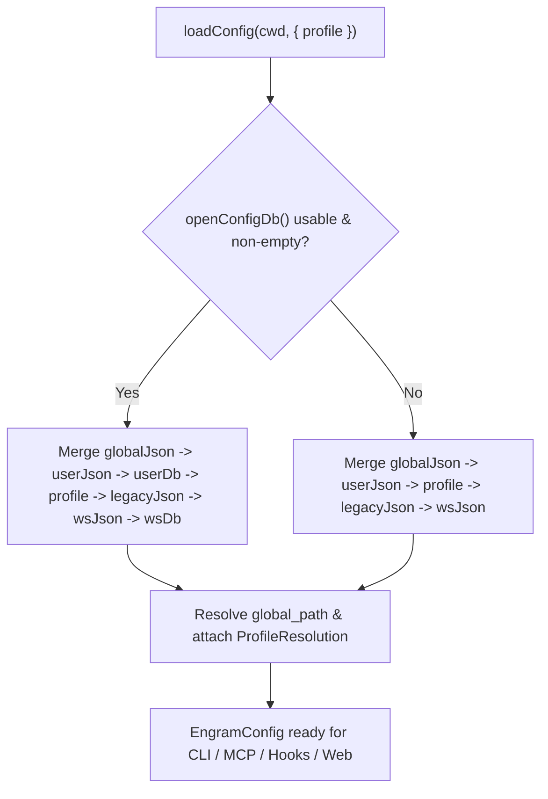

# Runtime, Config, and Profiles

## Purpose and boundaries

This architectural layer defines the shared runtime foundation used across the CLI, MCP server, agent hooks, and Entry Web UI: canonical domain types, configuration loading/merging/persistence, multi-profile isolation, one-time upgrade reconciliation, stable exit codes, and dependency-free system primitives.

In scope:
- Shared domain types (`EngramConfig`, `MemoryEntry`, `MemoryGraph`, `InboxReceipt`, `TraceUnit`, `ProfileResolution`, DB row types) in `src/core/runtime/types.ts`.
- Package constants, directory/sidecar names, working-tier path predicates, and generated version/docs-site metadata (`constants.ts`, `version.ts`, `docs-site.ts`).
- Configuration discovery, DB-first + JSON fallback layering, profile resolution, and config/profile persistence (`config.ts`, `profile-migration.ts`, `load-limit.ts`).
- Best-effort startup auto-upgrade reconciliation (`auto-upgrade.ts`), terminal runtime entry report (`entry.ts`), and typed domain errors/exit codes (`exit-codes.ts`).
- System utilities: atomic/locked file I/O and JSONC parsing (`fsx.ts`), deterministic lexical/vector text helpers (`text.ts`), BM25 stemming and scoring (`bm25.ts`), shell-free editor launch (`editor.ts`), and Node SQLite warning suppression (`warnings.ts`).

Out of scope:
- SQLite config database schema and query implementations (`src/core/config-db/*`, owned by storage/config-db specs).
- CLI command dispatch and user-facing command handlers (owned by `interface.cli-commands-and-dispatch`).
- Memory markdown parsing, routing algorithms, and upgrade inventory execution (owned by their respective core specs).

## Observable behavior

### Configuration loading and layering (`src/core/runtime/config.ts`)
- `loadConfig(cwd, { profile })` is **SQLite DB-first** (`configFromDb`) with automatic fallback to JSON files when the DB is unavailable or empty.
- Layer precedence (lowest to highest):
  1. `defaultConfig()`
  2. Active global root's `engram.config.json` (`author` stripped so global root files cannot override user/workspace author)
  3. User config JSON (`~/.engram/engram.config.json`, overridable via `ENGRAM_CONFIG_DIR`)
  4. User config DB (`user_config` table, DB-first path only)
  5. Active profile overlay (`global_path`, optional `scope` and `global_git`)
  6. Legacy workspace config (`.engram/engram.config.json`, `theme` stripped)
  7. Workspace config JSON (`.agents/.engram/engram.config.json`, `theme` stripped)
  8. Workspace config DB (`workspace_config` table, `theme` stripped, DB-first path only)
- `writeConfig` and `writeUserConfig` persist to SQLite first (when usable) and always export a JSON snapshot for backward compatibility. Workspace writes strip `theme` and preserve any pre-existing `global_path` when an active profile supplied the runtime `global_path`.
- Validated accessors enforce bounds:
  - `load.limit`: integer `1..32`, default `8` (`load-limit.ts`).
  - `load.max_tokens`: integer `200..16000`, default `1600` (`load-limit.ts`).
  - `load.working_ttl_days`: integer `1..365`, default `14` (`workingTtlDays`).
  - `mcp.resource_limit`: integer `0..200`, default `20` (`mcpResourceLimit`).
  - `hooks.path_rules`: `'hook'` or `'native'` (default `'native'`; omitted from `defaultConfig()` so workspace configs do not shadow user overrides).
  - `memory.include_author_email`: boolean, default `false`.
  - `learning`: optional `{ mode?: 'auto' | 'inbox' | 'off'; auto_drain?: boolean }` on `EngramConfig` (not populated in `defaultConfig()`, deep-merged across config layers in `mergeConfig`, and consumed by session-learning capture).

### Profile resolution and isolation (`config.ts`, `profile-migration.ts`)
- Profile registry lives at `<userConfigDir>/profiles.json` (`readProfileStore` reads JSON as source of truth; `writeProfileStore` writes DB + JSON snapshot).
- Active profile precedence: explicit `--profile` / `ENGRAM_PROFILE` (`env`) > `workspace.default_profile` / `legacy.default_profile` (`workspace`) > `store.active_profile` / `user.default_profile` (`user`) > `none`.
- **Cross-profile isolation**: `workspace_allowed` is `true` only when no profile is active, no workspace default is set, the active profile matches `workspace_default`, or the profile came from `workspace`. Selecting a different profile via `--profile` / `ENGRAM_PROFILE` disables workspace memory for that invocation.
- `resolveProfileForConfigs` attaches non-enumerable `ProfileResolution` metadata to the loaded `EngramConfig`, retrieved via `profileResolutionForConfig(config)`.
- `ensureDefaultProfile` performs one-time migration for pre-profile installs by promoting a single existing profile, a machine-named profile, or seeding a new profile from legacy `global_path` / `ENGRAM_GLOBAL_DIR` using sanitized `COMPUTERNAME`/`HOSTNAME`/`hostname()`/`USERNAME`/`USER`.

### Startup auto-upgrade (`src/core/runtime/auto-upgrade.ts`)
- `maybeAutoUpgrade` runs once per installed `VERSION` when `config.update === 'auto'`, unless skipped by `--no-auto-upgrade`, `ENGRAM_NO_AUTO_UPGRADE=1`, or read-only/meta commands (`help`, `llm`, `completion`, `inject`, `upgrade`, `version`, etc.).
- Migrates legacy `.engram/` to `.agents/.engram/` if needed, runs `ensureDefaultProfile` when a root's version marker lags `VERSION`, reconciles workspace and global scopes via `createScope`, refreshes generated workspace skillsets, and stamps `auto_upgrade: { version, checked_at }` in `engram.config.json`.
- Fails open unless `ENGRAM_AUTO_UPGRADE_STRICT=1`.

### Exit codes and runtime report (`exit-codes.ts`, `entry.ts`)
- `ExitCode` defines stable numeric exit codes: `Ok=0`, `GeneralError=1`, `UsageError=2`, `ConfigError=3`, `IntegrityError=4`, `PolicyError=5`, `RegressionError=6`, `NotFound=7`.
- `EngramError(code, message, exitCode, output?)` carries a stable contract error code and optional pre-rendered output.
- `renderEntry(cwd)` prints grouped runtime configuration, profile resolution, memory roots, and redacted global Git status (hiding `auto_upgrade`, `pattern_mining`, `pr_workflow`, and `encryption` rows).

### System utilities (`src/core/system/*`)
- `fsx.ts`: provides `exists`, `ensureDir`, `readJson`, `readJsonForUpdate` (retries Windows `EPERM`/`EBUSY`/`EACCES`), `writeJson`, `writeJsonAtomic`, `writeTextAtomic` (temp file + retried rename), `withFileLock` (`O_EXCL` `.lock` mutex with stale-lock breaking and `FileLockTimeoutError`), `writeJsonIfChanged` (ignores volatile keys like `last_updated`), `nearestGitRoot`, `readTextFromStdin`, `listFiles`, `inside` (root-containment path guard), and `parseJsonLike` (BOM + JSONC comment + trailing-comma stripper).
- `text.ts`: provides `slugify`, `tagsFrom`, `today` (supports `ENGRAM_TODAY=YYYY-MM-DD` strictly when `NODE_ENV=test`), Unicode-aware `words` (`/[\p{L}\p{N}][\p{L}\p{N}-]{1,}/gu`, preserving ASCII and Vietnamese words with `length > 2` plus `>=2`-char CJK tokens matching `CJK_RE`), `meaningfulWords` / `meaningfulWordList` (filters `ROUTING_STOPWORDS`—including 11 Vietnamese filler stopwords `của`, `cho`, `với`, `trong`, `khi`, `chưa`, `bên`, `này`, `các`, `những`, `được`—and generic memory words), `lexicalScore`, `routingVector` (deterministic FNV-1a hashed local vector with hyphen parts and 3-char grams), and `summarize`.
- `bm25.ts`: single-pass light suffix stemmer (`stem`, `MIN_STEM=3`), in-memory Lucene-style BM25 (`K1=1.2`, `B=0.75`) via `buildBm25`, and Robertson/Zaragoza field-weighted BM25F (`K1=1.2`, per-field `weight` and `b` via `Bm25FieldSpec`) via `buildBm25F`.
- `editor.ts`: resolves `$VISUAL` -> `$EDITOR` -> platform default (`notepad.exe`, `open -W -t`/`open -t`, `vi`/`xdg-open`) and launches via `spawn(..., { shell: false })`.
- `warnings.ts`: idempotently patches `process.emitWarning` to suppress Node's SQLite `ExperimentalWarning`.

## Workflow

## Code map

| Path | Responsibility |
| --- | --- |
| `src/core/runtime/types.ts` | Canonical TypeScript domain types for config, memories, graph, inbox receipts, traces, profiles, and DB rows. |
| `src/core/runtime/config.ts` | `defaultConfig`, `loadConfig`, `configFromDb`, `mergeConfig`, `writeConfig`, `writeUserConfig`, profile store/resolution, scope root helpers, validated config accessors. |
| `src/core/runtime/constants.ts` | Directory/file constants (`ENGRAM_DIR`, `WORKING_DIR`, `MEMORY_DIRS`, sidecar filenames), `isWorkingPath`, `isActiveMemoryPath`, `DEFAULT_IGNORE`, `GENERATED_HEADER`. |
| `src/core/runtime/load-limit.ts` | Bounds and normalizers/parsers for `load.limit` (`1..32`) and `load.max_tokens` (`200..16000`). |
| `src/core/runtime/profile-migration.ts` | `ensureDefaultProfile`, `machineProfileName`, `defaultProfileLines` for pre-profile upgrades. |
| `src/core/runtime/auto-upgrade.ts` | `maybeAutoUpgrade` version-gated startup reconciliation and legacy `.engram` rename. |
| `src/core/runtime/entry.ts` | `renderEntry` grouped runtime/profile/root/Git diagnostic report. |
| `src/core/runtime/exit-codes.ts` | `ExitCode`, `EngramError`, `exitCodeFor`, `errorCodeFor`. |
| `src/core/runtime/version.ts` | Build-generated `VERSION` constant from `package.json`. |
| `src/core/runtime/docs-site.ts` | Build-generated `DOCS_SITE_BASE_URL`, `DOCS_SITE_VERSIONS`, `DOCS_SITE_LATEST_VERSION`. |
| `src/core/system/fsx.ts` | Path containment (`inside`), atomic writes, cross-process file locking (`withFileLock`), JSONC parsing (`parseJsonLike`), stdin and recursive file helpers. |
| `src/core/system/text.ts` | Deterministic `slugify`, `today`, `words`, `meaningfulWords`, `lexicalScore`, `routingVector`, `summarize`. |
| `src/core/system/bm25.ts` | `stem`, `buildBm25`, `buildBm25F`, and `Bm25FieldSpec` lexical ranking indexes. |
| `src/core/system/editor.ts` | `splitEditorCommand`, `resolveEditorCommand`, `launchEditor` without shell interpolation. |
| `src/core/system/warnings.ts` | `suppressSqliteExperimentalWarning`. |

## Interfaces and data

### Key configuration contracts
- `EngramConfig` (`src/core/runtime/types.ts`): top-level runtime config including `scope`, `update`, `read`, `proof`, `ignore`, `roles`, `live_sync`, `global_git`, `rule_variants`, `load`, `graph`, `vector`, `pattern_mining`, `pr_workflow`, `encryption`, `memory`, optional `mcp`, optional `hooks`, and optional `learning`.
- `ProfileStore` / `EngramProfile` / `ProfileResolution`: user-level profile map and computed resolution metadata (`active`, `source`, `configured`, `global_path`, `workspace_default`, `user_default`, `workspace_allowed`, `profiles_path`).
- Environment variables recognized by runtime/system modules:
  - `ENGRAM_CONFIG_DIR`: overrides `~/.engram` user config directory.
  - `ENGRAM_GLOBAL_DIR`: overrides configured global memory root (ignored when an active profile is selected).
  - `ENGRAM_PROFILE`: selects active profile with highest precedence (`source: 'env'`).
  - `ENGRAM_NO_AUTO_UPGRADE=1` / `ENGRAM_AUTO_UPGRADE_STRICT=1`: disables or strict-fails startup auto-upgrade.
  - `ENGRAM_TODAY=YYYY-MM-DD`: test-only date override (honored only when `NODE_ENV=test`).
  - `VISUAL` / `EDITOR`: editor command resolution in `editor.ts`.

### Working-tier path invariants (`constants.ts`)
- Active memory paths match `/^(?:working\/)?(?:rules|skills|knowledge)\//` with `.md` extension (`isActiveMemoryPath`).
- Working-tier paths match `/^(?:archive\/[^/]+\/)?working\//` (`isWorkingPath`) and use gitignored sidecars under `working/` (`WORKING_INDEX_FILE`, `WORKING_GRAPH_FILE`, `WORKING_HASH_FILE`).

## Verification

- Config layering, profile isolation, profile migration, auto-upgrade, exit codes, load-limit validation, BM25 ranking, atomic/locked file I/O, JSONC parsing, and editor launching are verified by unit and integration tests under `tests/`.
- Run `npm test` to validate runtime and system invariants.

## Related documentation

- [CLI Commands and Dispatch](../interfaces/cli-commands-and-dispatch.md)
- [Memory Schema and Storage](../architecture/memory-schema-and-storage.md)
- [Retrieval, Routing, and Ordering](../features/retrieval-routing-and-ordering.md)
- [Working Memory and Freshness](../features/working-memory-and-freshness.md)
- [Session Learning and Traces](../workflows/session-learning-and-traces.md)
- [Upgrade, VCS, and Diagnostics](../workflows/upgrade-vcs-and-diagnostics.md)
- [Entry Web API](../interfaces/entry-web-api.md)
- [MCP Server and Protocol](../interfaces/mcp-server-and-protocol.md)
- [Build, Test, and Release Scripts](../workflows/build-test-and-release-scripts.md)
- [Docs Website and Field Sync](../architecture/docs-website-and-field-sync.md)

## Known limitations and open questions

- `readProfileStore()` always reads `profiles.json` directly even when SQLite config DB is active, whereas `writeProfileStore()` dual-writes to SQLite and `profiles.json`.
- `version.ts` and `docs-site.ts` are generated artifacts produced by `scripts/generate-version.mjs` and should never be hand-edited.

<!-- BEGIN MANUAL NOTES -->
<!-- END MANUAL NOTES -->
