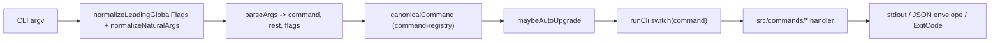

# CLI Commands and Dispatch

## Purpose and boundaries

This interface owns the Engram CLI surface: argument parsing, natural-language command normalization, alias resolution, dispatch, terminal/JSON formatting, help and shell-completion generation, and the thin command handlers under `src/commands/`.

In scope:
- Entrypoint execution (`main`, `runCli`) and top-level error/exit-code formatting (`src/cli.ts`).
- Dependency-free argument and flag parsing with natural-language rewrites (`src/cli/args.ts`).
- Canonical command registry, aliases, slash-command surface, help topics, ANSI formatting, completion scripts, and `--json` success envelopes (`src/core/cli/*`).
- All CLI subcommand handlers (`src/commands/*`) that validate arguments, coordinate interactive prompts/approvals, and delegate domain work to `src/core/*`.

Out of scope:
- Underlying config persistence, profile resolution, exit-code definitions, and filesystem/BM25 utilities (owned by `architecture.runtime-config-and-profiles`).
- Core memory storage, routing, working-tier lifecycle, save planning, session learning, policy evaluation, host hooks/skillsets, and upgrade execution engines (owned by their respective core specs).

## Observable behavior

### Entrypoint, `--profile`, and error handling
- Running `engram` with no command defaults to `entry` (`cmdEntry`, which launches the Entry Web UI unless `NODE_ENV=test`, where it renders `renderEntry()`).
- Leading `--profile <name>` or `--profile=<name>` flags are hoisted to the end of argv before parsing; `runCli` temporarily sets `process.env.ENGRAM_PROFILE` for the duration of the command and restores it in `finally`.
- `-h` / `--help` on any command routes to `cmdHelp(topic)` (including two-word `author <subtopic>` help); `-v` / `--version` / `version` returns `VERSION`.
- Before dispatching any non-skipped command, `runCli` runs `maybeAutoUpgrade(process.cwd(), command, flags)`.
- `main()` prints `EngramError.output` directly when present, otherwise emits a versioned JSON failure envelope (`serializeResult(fail(...))`) when `--json` is in `argv` or `engram: <message>` on `stderr`, and exits via `exitCodeFor(error)`.

### Argument parsing and natural-language normalization
- `parseArgs` supports `--flag=value`, `--flag value`, boolean flags (`booleanFlags`), and repeatable flags (`depends-on`, `dir`, `exclude`, `file`, `include`, `id`, `update`, `children`, `child`).
- `-f` maps to `--full` on `load`/`ld` and to `--force` on `save-session`/`ss`, `take-control`/`tc`, `metacognize`/`mc`, and `resolve-conflicts`/`rc`.
- Removed legacy batch-approval (`-a` and its long accept-all flag) and legacy agent-output flags throw explicit migration errors.
- Natural-language rewrites normalize phrases such as `rehash memory` / `refresh hashes`, `restructure workspace memory force`, `clone workspace memory to global and metacognize`, `move global folder from A to B`, `resolve conflicts and metacognize`, `take control force`, `config show`, `workspace list`, `install-skill set`, and `ss -f last 50 sessions` (`--query-level 50`).

### Read, routing, and diagnostics commands (`src/commands/read.ts`, `status.ts`, `why.ts`)
- `load` (`ld`): routes compact agent context by default via `planLoad` + `agentLoadResult`, supporting `--id`, `--all`, `--budget-tokens`, `--disclosure auto|full`, `--exclude-keys`, `--dry-run`, `--explain`, `-f`/`--full`, and `--json`. Explicit `--id` fetches bypass routing/budget and record local `fetched` usage; archived hits emit a stderr warning.
- `agentLoadResult(ctx, plan)` is the single shared rendering path used by `cmdLoad`, `loadForAgent`, `loadForAgentWithContext`, agent hooks, and benchmarks. It returns `AgentLoad` (`text`, `selectedKeys`, `bodyKeys`, `related`, `alreadyLoaded`, `cardIds`, `omittedIds`).
- `route` (`rt`): classifies a task via `classifyTaskType` and renders `Task type`, `Confidence`, `Load query`, and `Save tags` (or JSON).
- `status` (`stat`, `src/commands/status.ts`): renders a unified one-screen workspace/global status dashboard (`Profile`, durable/working/expired memory counts, pending findings and inbox/`session-learning` receipts, stale sources, noisy memories, linked hooks, and prioritized `Next:` actions) with `--json` support.
- `why` (`src/commands/why.ts`): explains why `<memory-id>` matched (`expanded_body`, `card`), was omitted (`omitted_budget`, `omitted_limit`), missed (`rejected_no_anchor`), was excluded (`excluded_lifecycle`), or was `not_found` for an optional `[query]` (default `'current session'`), reporting rank, score, matched/missing stems, token budget, and an actionable hint (text or `--json`).
- `verify` (`vf`): verifies memory hashes across scopes, exiting with `ExitCode.IntegrityError` (4) on mismatch; `--sources` re-hashes `take-control` source files and updates gitignored `stale.json` without failing `verify`.
- `rehash` (`rh`), `rebuild-index` (`ri`), `repair` (`rp`, including `--move-backups [--confirm]`), `doctor` (`--strict`, `--json`), and `audit` (`a`, `--author`, `--stale`, `--low-confidence`).

### Write, working-tier, and restructuring commands (`src/commands/write.ts`, `working-note.ts`, `metacognize.ts`, `clone.ts`)
- `save` (`s`): drafts one memory (auto-detecting type or using `rule|skill|workflow|knowledge`), prompts to switch to `save-session` for long TTY inputs (>800 chars or >=8 lines), resolves task type, previews `Verdict:` (`ADD`, `UPDATE`, `SUPERSEDE`, `NOOP`), and requires A/B/C approval. Unpreviewed `--force` never applies `SUPERSEDE`.
- `save-session` (`ss`): proposes multiple `TYPE: ... | TEXT: ...` candidates from inline text, `--file` (including `-` stdin and evidence wrappers under `inbox/`), or interactive agent generation (`--query-level`). Under `--force`, ready candidates write immediately while candidates with unresolved related-memory hints or unapproved `SUPERSEDE` are deferred with ID-only `engram load --id` guidance; `--inbox` writes resumable receipts under `inbox/`.
- `take-control` (`tc`): scans workspace docs/code/config (`--plan`, `--kind`, `--file`, `--dir`, `--include`, `--exclude`, `--max-sources`, `--max-chars`, `--budget-tokens`, `--objective`, `--all`), refreshes stale memories (`--refresh`), or imports host-local memory stores (`--from claude-auto-memory|codex-memories`). Candidates with `OBJECTIVE: task` write to the gitignored working tier; candidates with `SCOPE:` outside the command scope are deferred under `--force`.
- `promote <id>`: promotes an unexpired working-tier memory to durable memory after A/B/C approval.
- `working prune [--dry-run]` deletes expired working memories and lists undated ones; `working note "<text>" [--objective] [--type knowledge|rule] [--scope]` proposes a redacted working-tier task note with a single yes/cancel prompt (`src/commands/working-note.ts`).
- `metacognize` (`mc`): builds a hash-verified source pack for `--workspace`, `--global`, or `--all` and routes restructuring candidates through `runSaveSessionCandidates`.
- `clone-memory` (`cm`): mechanically clones verified active memories between `workspace` and `global` (rewriting `scope:` frontmatter and rebuilding target index/graph/vector), or routes them through `--metacognize` (disallowed with `--force`).

### Observe and session learning commands (`src/commands/observe.ts`, `observe-queue.ts`)
- `observe` (`o`): without `--queue` or `--learn`, captures raw text or `--file` (`-` for stdin) into non-indexed `inbox/` and `traces/` via `writeObservation`, optionally chaining into `save-session` when `--propose` is set.
- `observe --learn`: distills deterministic learnings via `captureSessionLearnings` from inline text, `--file <path>` (`-` stdin), or recent non-merge commits via `--git [range]` (`harvestGitLearnings`). Supports `--json`, returning `{ working_written, receipts_written, skipped_duplicates, trace_id? }`.
- `observe --queue [--dry-run] [--limit n] [--learn]`: drains gitignored `session-queue.json` using optional `.agents/engram.transcripts.json` quotas. Rejects note text, `--file`, and `--propose`. When `--learn` is passed (and not `--dry-run`), runs `learnFromQueueOutcomes` to activate working memories and stage durable inbox receipts.

### Review, policy, autosave, and operational commands
- `review` (`src/commands/review.ts`): `list`, `inbox`, `inspect` (finding fingerprint or `r-*` receipt ID), `dismiss` (single finding, single `r-*` receipt purged across `[workspace, global]` roots via `cmdReviewDismiss`, or bulk `--all`/`--kind` findings with confirmation unless `--force`), `verify`, `supersede`, `archive`, `apply` (with `--depends-on` / `--update` relation overrides), `triage` (also triggered via `review --interactive` for interactive approve/dismiss/skip triage of inbox receipts), and `cleanup`. Never exposes memory bodies or authors.
- `policy` (`src/commands/policy.ts`): `init`, `show`, `validate [--strict]`, `audit`, and `rollback <audit-id>`.
- `autosave` (`src/commands/autosave.ts`): requires `--policy`; evaluates candidate against local policy, defers implicit updates/duplicates, enforces daily quota, stages snapshots, writes approved memory, and appends an ID-only policy audit record.
- `ops` (`src/commands/ops.ts`): `health`, `search` (`--semantic`, labels `[working]`/`[working, expired]`), `quality-check`, `graph` (`--rebuild`, plus `graph link <parent-id> <child-id...>` / `--parent`/`--children` delegating to `linkMemoryChildren`), `benchmark` (`--baseline`, `--policy`, `--fail-on`, `--write-report`, exiting with `ExitCode.RegressionError` 6 on failure, plus `--from-git [range] [--max n] [--out <path>]` to mine redacted benchmark cases from Git history via `mineBenchmarkCasesFromGit`), `archive`, `deduplicate`, `export` (`--format` or JSON bundle), `import` (Engram or `agentmemory` JSON through approval gate), `stats` (`--usage` reporting `never_fetched` and `noisy` memories via `noisyMemories`, plus `--backfill [--git <range>] [--limit n]` running `backfillUsageFromGit`), `entry` (`--host-only`), and `sync`.

### Init, admin, profile, workspace, config, author, link, and upgrade commands
- `inject` (`src/commands/core.ts`, `init-plans.ts`): prints `INIT_WORDMARK`, plans optional workspace submodule and global path/remote (interactive when TTY), initializes scopes, ensures default profile, and installs default `codex` skillset unless `--no-skillset` or `--global-only`.
- `help` (`--compact` renders the concise quick-reference via `renderCompactHelpTerminal`), `llm` (reads packaged `llm.txt`), `completion [bash|zsh|powershell]` (`completion.ts` includes `--learn`, `--git`, `--json` for `observe` and `--json`, `--baseline`, `--write-report`, `--fail-on` for `benchmark`, with orphaned bash/zsh case bodies removed).
- `profile` (`pf`, `src/commands/profile.ts`): `list`, `status`, `create`, `use`, `remove`, and `merge` (copies verified active memories between profiles with duplicate detection and global Git commit).
- `author` (`src/commands/author-cmd.ts`): `show`, `set`, `unset`, `sync-git-global` (`--plan`/`--confirm`), `migrate-memories` (`--strip-email`, `--plan`/`--confirm`).
- `config` (`cfg`, `src/commands/config-cmd.ts`): `view`/`show` (SQLite DB-first + profiles/workspaces summary or JSON fallback) and `set <key> <value>` (user-level DB + JSON snapshot).
- `workspace` (`ws`, `src/commands/workspace.ts`): `list`, `info`, `set`, `unregister`, `link`, `unlink` backed by SQLite config DB.
- `link` / `unlink` (`src/commands/skillset-link.ts`): installs/removes host skillsets, MCP configs, agent hooks (including opt-in `--session-end`), and native Claude/Cursor path rules; when `--parent` and `--children`/`--child` are passed, bulk-links memory dependencies via `linkMemoryChildren`.
- `admin` (`src/commands/admin.ts`, `upgrade-review.ts`): `ignore`, `set-role`, `set-save-target`, `set-load-limit`, `set-proof`, `set-read` (refreshes native rules), `set-rule-variant`, `update-global-folder`, `resolve-conflicts` (optional `--metacognize`), `install-hooks`, `agent-hook` (reads JSON from stdin), and `upgrade` (supports legacy scoped flags, `--db-migrate`, and the shared `--latest` inventory/plan/interactive `--review`/transactional apply flow).
- `capabilities` (`src/commands/capabilities.ts`): prints host adapter capability matrix in text or JSON.

## Workflow

## Code map

| Path | Responsibility |
| --- | --- |
| `src/cli.ts` | `runCli`, `main`, stdin helper, `--profile` env scoping, error/exit-code handling. |
| `src/cli/args.ts` | `parseArgs`, `listFlag`, `hasFlag`, `flag`, `flagValues`, `textArg`, natural-language normalizers, removed-flag guards. |
| `src/core/cli/command-registry.ts` | `HELP_DATA`, `commandPrefixes`, `slashCommandSurface`, `commandAliases`, `canonicalCommand`, `commandNames`. |
| `src/core/cli/help.ts` | `renderHelp` (`HELP.md`), `renderCompactHelpTerminal` (`help --compact`), `renderHelpTerminal`, `renderMemoryReadme`. |
| `src/core/cli/help-topics.ts` | `COMMAND_TOPICS` detailed per-command summaries, use cases, examples, notes, and `detailForTopic`. |
| `src/core/cli/completion.ts` | `completionScript` for `bash`, `zsh`, and `powershell`. |
| `src/core/cli/completion-target.ts` | `detectCompletionTarget` from shell/platform environment variables. |
| `src/core/cli/format.ts` | TTY-aware ANSI `style`, `terminalWidth`, `wrapText`, `formatField`, `formatFields`, `formatRecords`, `formatCounts`. |
| `src/core/cli/banner.ts` | `INIT_WORDMARK` and `renderInitWordmark`. |
| `src/core/cli/json-output.ts` | `isJsonMode` and `jsonOk` versioned JSON envelope helper. |
| `src/commands/core.ts` | `cmdInject`, `cmdHelp`, `cmdLlm`, `cmdCompletion`. |
| `src/commands/init-plans.ts` | Interactive and flag-driven plans for global path, global remote, and workspace submodule during `inject`. |
| `src/commands/read.ts` | `cmdLoad`, `loadForAgent`, `loadForAgentWithContext`, `agentLoadResult`, `cmdRoute`, `cmdRebuildIndex`, `cmdRepair`, `cmdVerify`, `cmdAudit`, `cmdRehash`, `cmdDoctor`. |
| `src/commands/write.ts` | `cmdSave`, `cmdSaveSession`, `runSaveSessionCandidates`, `cmdTakeControl`, `commitApprovedCandidates`, `planCandidates`, `forceRestructureResponse`, `cmdPromote`, `cmdWorking`. |
| `src/commands/working-note.ts` | `cmdWorkingNote` single-prompt working-tier note writer. |
| `src/commands/observe.ts` | `cmdObserve` (inbox capture, `--propose`, `--learn`, `--learn --git`, `--queue` dispatch). |
| `src/commands/observe-queue.ts` | `cmdObserveQueue` SessionEnd transcript queue drainer and optional `--learn` distillation. |
| `src/commands/metacognize.ts` | `cmdMetacognize` hash-verified memory pack builder and restructuring flow. |
| `src/commands/clone.ts` | `cmdCloneMemory` mechanical and `--metacognize` scope-to-scope cloning. |
| `src/commands/ops.ts` | `cmdHealth`, `cmdSearch`, `searchMemories`, `cmdQuality`, `cmdGraph`, `cmdBenchmark`, `cmdArchive`, `cmdDeduplicate`, `cmdExport`, `cmdImport`, `cmdStats`, `cmdEntry`, `cmdSync`. |
| `src/commands/review.ts` | `cmdReview` findings queue and deferred-save inbox receipt commands. |
| `src/commands/policy.ts` | `cmdPolicy` policy init/show/validate/audit/rollback. |
| `src/commands/autosave.ts` | `cmdAutosave` policy-gated autonomous single-candidate write. |
| `src/commands/capabilities.ts` | `cmdCapabilities` host adapter capability report. |
| `src/commands/author-cmd.ts` | `cmdAuthor` author profile and memory migration CLI. |
| `src/commands/profile.ts` | `cmdProfile` profile registry CRUD and cross-profile merge. |
| `src/commands/config-cmd.ts` | `cmdConfig` DB-first/JSON user config view and dotted-key set. |
| `src/commands/workspace.ts` | `cmdWorkspace` SQLite workspace registry and per-workspace config commands. |
| `src/commands/skillset-link.ts` | `cmdLink`, `cmdUnlink`, `cmdInstallSkillset`, `installResultRecords`, memory parent-link mode. |
| `src/commands/status.ts` | `cmdStatus` unified one-screen status dashboard (`status` / `stat`) with `--json` output and prioritized next actions. |
| `src/commands/why.ts` | `cmdWhy` single-memory routing diagnostic (`why <id> [query]`) reporting status, rank, score, matched/missing stems, budget, and hint. |
| `src/commands/admin.ts` | `cmdIgnore`, `cmdSetRole`, `cmdSetSaveTarget`, `cmdSetLoadLimit`, `cmdSetRuleVariant`, `cmdSetRead`, `cmdSetProof`, `cmdUpdateGlobalFolder`, `cmdResolveConflicts`, `cmdInstallHooks`, `cmdInstallAgentHooks`, `cmdUninstallAgentHooks`, `cmdAgentHook`, `cmdUpgrade`. |
| `src/commands/upgrade-review.ts` | `reviewUpgradeConflicts` and `confirmReviewedUpgrade` interactive conflict resolution UI. |

## Interfaces and data

### Shared CLI types
- `ParsedArgs` (`src/cli/args.ts`): `{ command: string; rest: string[]; flags: Record<string, string | boolean | string[]> }`.
- `AgentLoadOptions` / `AgentLoad` (`src/commands/read.ts`): shared load contract between CLI `load`, MCP, hooks, and benchmarks.
- `SaveSessionCandidateRunOptions` / `PlannedCandidate` / `PlanCandidateOptions` / `ScopeGuard` (`src/commands/write.ts`): shared candidate-planning and commit contracts used by CLI write commands and MCP `engram_commit`.
- `SearchResultRow` / `SearchData` (`src/commands/ops.ts`), `RouteData` (`src/commands/read.ts`), `CommandHelp` / `HelpSection` (`src/core/cli/command-registry.ts`), `CommandTopicHelp` (`src/core/cli/help-topics.ts`), `CompletionTarget` (`src/core/cli/completion-target.ts`), `Field` / `RecordBlock` (`src/core/cli/format.ts`).

### JSON contract mode
- Read-only and CI-oriented commands (`load`, `route`, `verify`, `repair`, `doctor`, `audit`, `health`, `search`, `quality-check`, `benchmark`, `deduplicate`, `stats`, `review`, `policy`, `autosave`, `capabilities`, `author`, `observe --learn`) honor `--json` via `jsonOk(...)` and emit versioned envelopes from `src/core/contracts/result.ts`.
- `take-control --plan --json` and `upgrade --latest --plan --json` serialize raw plan/result JSON directly.

## Verification

- CLI dispatch, argument normalization, help/completion rendering, and subcommand behaviors are exercised by unit and integration tests under `tests/` (including CLI args, observe/learn/queue, load/route/verify/doctor, save/save-session/take-control/working, review/policy/autosave, profile/config/workspace, and upgrade review suites).
- Run `npm test` to verify the full CLI and core suite.

## Related documentation

- [Runtime, Config, and Profiles](../architecture/runtime-config-and-profiles.md)
- [Memory Schema and Storage](../architecture/memory-schema-and-storage.md)
- [Retrieval, Routing, and Ordering](../features/retrieval-routing-and-ordering.md)
- [Working Memory and Freshness](../features/working-memory-and-freshness.md)
- [Memory Save and Take Control](../features/memory-save-and-take-control.md)
- [Session Learning and Traces](../workflows/session-learning-and-traces.md)
- [Safety, Policy, and Review](../architecture/safety-policy-and-review.md)
- [Ingest, Author, and Benchmarks](../features/ingest-author-and-benchmarks.md)
- [Agent Hooks and Skillsets](../features/agent-hooks-and-skillsets.md)
- [Upgrade, VCS, and Diagnostics](../workflows/upgrade-vcs-and-diagnostics.md)
- [Entry Web API](../interfaces/entry-web-api.md)
- [MCP Server and Protocol](../interfaces/mcp-server-and-protocol.md)

## Known limitations and open questions

- `src/core/cli/completion.ts` still matches legacy `link|is` (while `command-registry.ts` defines alias `l`).
- `src/commands/workspace.ts` (`workspaceSet`) writes `(config as any)[key.replace('.', '_')] = value` to the JSON snapshot instead of applying nested dotted keys like `src/commands/config-cmd.ts` (`applyDottedKey`).
- `cmdCompletion` defaults to `bash` when no shell argument is passed rather than calling `detectCompletionTarget` automatically.

<!-- BEGIN MANUAL NOTES -->
<!-- END MANUAL NOTES -->
