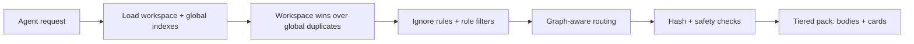

# Read path and routing

The read flow decides which memory an agent sees for a given task.

## Read flow

1. Engram loads workspace and optional global indexes.
2. Workspace entries win over global duplicates.
3. Ignore rules and role filters hide irrelevant entries.
4. Graph-aware routing selects a compact context pack.
5. Hash and safety checks run before content is printed.

## Anchor, rank, and refine

`load` first anchors routing on meaningful query terms, ignoring generic memory words such as `rule`, `knowledge`, and common stopwords. It then ranks the candidates with BM25 (light stemming) over id, tags, `directive`, summary, triggers, and content terms. The score is scaled by lifecycle (`review_due` x0.7), staleness (x0.6), confidence (`medium` x0.9), and scope (workspace x1.1), plus a small boost for memories agents have fetched. Memories whose `valid_until` has passed are left out with the omission reason `lifecycle`. A query with four or more anchors needs two anchor hits, or one hit on a strong field (id, tag, `directive`, or an `applies_to` path). Vector hits without a term overlap never admit a memory.

Finally it refines the wider candidate pool into a compact context pack.

Normal load reports selected and total related counts, like `loaded 8 memory files / 14 total related memories`.

- `load --dry-run` shows candidate counts, narrowing tags, and match reasons.
- `load --all` returns every visible routed match instead of applying the compact limit.
- Default `load` is the agent-facing compact route. Use `load --full` for broader legacy output.

## Tiered disclosure

The default agent output is tiered (`load.disclosure: auto`):

- The top `load.expand_top` hits (default 3) print as bodies under `### <id> [<type>, <authority>]`, with `requires: <ids>` when the memory has `depends_on`.
- Every other selected hit, plus up to 5 omitted candidates, prints as one card line, `- <id> [<type>] <directive-or-summary>`, with ` (stale)` appended when its sources changed.
- The output ends with `fetch: engram load --id <ids>` so the agent can pull a full body only when it needs one.

Frontmatter, `## Context`, `## Example`, and `## Origin` are never rendered for agents. `--budget-tokens` caps the complete output: Engram first turns bodies into cards, and only then drops the lowest-ranked cards. Use `--disclosure full`, `--full`, or `--all` to skip tiering.

## Hook delta and path triggers

Hooks remember which memory keys they already delivered in the session. Later prompt turns inject only the bodies that are new and collapse the rest into one `already loaded: <ids>` line. `SessionStart` and `PreCompact` reset the set. Memories with `applies_to` globs are also injected just in time on `PreToolUse` file events (Codex `apply_patch` edits; Claude `Read`, `Edit`, `Write`, `MultiEdit` in hook mode) and on Gemini `AfterTool` events (`read_file`, `write_file`, `replace`), at most 3 bodies per event. With `hooks.path_rules native` (default) Claude and Cursor instead load them from generated rule files under `.claude/rules/engram/` and `.cursor/rules/engram/`, and the Claude `InstructionsLoaded` hook feeds the delivered set. Claude and Codex subagents start with the routed context through `SubagentStart`, and hook output stays under each host's payload cap (2,400 tokens on Codex, 9,500 characters on Claude): over the cap, bodies demote to cards and are never cut mid-text. See [Hooks and proof lines](../integrations/hooks.md).

`workflow` and `workflows` still route to skill memories, but generic type words do not make a broad match by themselves.

## Dependency layers

Use `depends_on` frontmatter when a memory should build on another memory instead of repeating it:

```yaml
depends_on: [release-foundation]
level: advanced
```

Run `engram graph --rebuild` after manual edits. The graph reports dependency layers, and `engram load` pulls routed prerequisites into the same compact context pack before deeper memories. Graph related edges and vector hits cannot load unrelated memories by themselves; they only help rerank or expand memories that already overlap meaningful query terms. Explicit `depends_on` prerequisites may still load without their own keyword overlap.

## Routing diagram



## Next steps

- [Write path and approval](write-path.md)
- [CLI: load / search / graph](../cli/load-search-graph.md)
