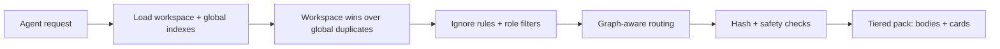

# Ruta de lectura y enrutamiento

El flujo de lectura decide qué memoria ve un agente para una tarea determinada.

## Flujo de lectura

1. Engram carga los índices del workspace y, opcionalmente, los globales.
2. Las entradas del workspace prevalecen sobre los duplicados globales.
3. Las reglas de exclusión y los filtros de rol ocultan las entradas irrelevantes.
4. El enrutamiento basado en el grafo selecciona un paquete de contexto compacto.
5. Se ejecutan comprobaciones de hash y de seguridad antes de imprimir el contenido.

## Anclar, clasificar y refinar

`load` ancla primero el enrutamiento en los términos significativos de la consulta, ignorando palabras genéricas de memoria como `rule`, `knowledge` y las palabras vacías habituales. Después clasifica las candidatas con BM25 (con stemming ligero) sobre el id, las etiquetas, `directive`, el resumen, los disparadores y los términos del contenido. La puntuación se escala según el ciclo de vida (`review_due` x0.7), la obsolescencia (x0.6), la confianza (`medium` x0.9) y el ámbito (workspace x1.1), más un pequeño impulso para las memorias que los agentes han obtenido. Las memorias cuyo `valid_until` ya pasó se dejan fuera con el motivo de omisión `lifecycle`. Una consulta con cuatro o más anclas necesita dos coincidencias de ancla, o una coincidencia en un campo fuerte (id, etiqueta, `directive` o una ruta de `applies_to`). Las coincidencias vectoriales sin solapamiento de términos nunca admiten una memoria.

Por último, refina el conjunto más amplio de candidatas hasta un paquete de contexto compacto.

La carga normal informa de los recuentos seleccionados y del total relacionado, como `loaded 8 memory files / 14 total related memories`.

- `load --dry-run` muestra los recuentos de candidatas, las etiquetas de acotación y los motivos de coincidencia.
- `load --all` devuelve todas las coincidencias enrutadas visibles en lugar de aplicar el límite compacto.
- El `load` por defecto es la ruta compacta orientada al agente. Use `load --full` para una salida heredada más amplia.

## Divulgación por niveles

La salida por defecto para agentes está organizada por niveles (`load.disclosure: auto`):

- Los mejores `load.expand_top` resultados (3 por defecto) se imprimen como cuerpos bajo `### <id> [<type>, <authority>]`, con `requires: <ids>` cuando la memoria tiene `depends_on`.
- Cada uno de los demás resultados seleccionados, más hasta 5 candidatas omitidas, se imprime como una línea de tarjeta, `- <id> [<type>] <directive-or-summary>`, con ` (stale)` añadido cuando sus fuentes cambiaron.
- La salida termina con `fetch: engram load --id <ids>` para que el agente obtenga un cuerpo completo solo cuando lo necesite.

El frontmatter, `## Context`, `## Example` y `## Origin` nunca se presentan a los agentes. `--budget-tokens` limita la salida completa: Engram convierte primero los cuerpos en tarjetas y solo después descarta las tarjetas de menor clasificación. Use `--disclosure full`, `--full` o `--all` para omitir los niveles.

## Delta de hooks y disparadores por ruta

Los hooks recuerdan qué claves de memoria ya entregaron en la sesión. Los turnos posteriores inyectan solo los cuerpos nuevos y condensan el resto en una línea `already loaded: <ids>`. `SessionStart` y `PreCompact` reinician el conjunto. Las memorias con globs de `applies_to` también se inyectan justo a tiempo en los eventos de archivo de `PreToolUse` (ediciones `apply_patch` de Codex; `Read`, `Edit`, `Write`, `MultiEdit` de Claude en modo hook) y en los eventos `AfterTool` de Gemini (`read_file`, `write_file`, `replace`), con un máximo de 3 cuerpos por evento. Con `hooks.path_rules native` (por defecto), Claude y Cursor las cargan en su lugar desde archivos de reglas generados en `.claude/rules/engram/` y `.cursor/rules/engram/`, y el hook `InstructionsLoaded` de Claude alimenta el conjunto entregado. Los subagentes de Claude y Codex empiezan con el contexto enrutado mediante `SubagentStart`, y la salida de los hooks se mantiene por debajo del límite de carga útil de cada host (2400 tokens en Codex, 9500 caracteres en Claude): por encima del límite, los cuerpos pasan a tarjetas y nunca se cortan a mitad de texto. Consulte [Hooks y líneas de prueba](../integrations/hooks.md).

`workflow` y `workflows` siguen enrutando a memorias de skill, pero las palabras genéricas de tipo no producen por sí solas una coincidencia amplia.

## Capas de dependencia

Use el frontmatter `depends_on` cuando una memoria deba apoyarse en otra en lugar de repetirla:

```yaml
depends_on: [release-foundation]
level: advanced
```

Ejecute `engram graph --rebuild` tras ediciones manuales. El grafo informa de las capas de dependencia, y `engram load` incorpora los prerrequisitos enrutados al mismo paquete de contexto compacto antes de las memorias más profundas. Las aristas relacionadas del grafo y las coincidencias vectoriales no pueden cargar por sí solas memorias no relacionadas; solo ayudan a reordenar o ampliar memorias que ya comparten términos significativos de la consulta. Los prerrequisitos explícitos de `depends_on` pueden cargarse aunque no compartan palabras clave.

## Diagrama de enrutamiento



## Próximos pasos

- [Ruta de escritura y aprobación](write-path.md)
- [CLI: load / search / graph](../cli/load-search-graph.md)
