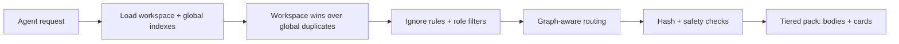

# Chemin de lecture et routage {#read-path-and-routing}

Le flux de lecture détermine quelle mémoire un agent voit pour une tâche donnée.

## Flux de lecture {#read-flow}

1. Engram charge les index du workspace et, le cas échéant, les index globaux.
2. Les entrées du workspace l’emportent sur les doublons globaux.
3. Les règles d’ignorance et les filtres de rôle masquent les entrées non pertinentes.
4. Le routage par graphe sélectionne un lot de contexte compact.
5. Les contrôles de hachage et de sûreté s’exécutent avant l’affichage du contenu.

## Ancrer, classer et affiner {#anchor-rank-and-refine}

`load` ancre d’abord le routage sur les termes significatifs de la requête, en ignorant les mots génériques de mémoire comme `rule`, `knowledge` et les mots vides courants. Il classe ensuite les candidats avec BM25 (racinisation légère) sur l’identifiant, les étiquettes, `directive`, le résumé, les déclencheurs et les termes du contenu. Le score est pondéré selon le cycle de vie (`review_due` x0.7), l’obsolescence (x0.6), la confiance (`medium` x0.9) et la portée (workspace x1.1), avec un léger bonus pour les mémoires que les agents ont récupérées. Les mémoires dont `valid_until` est dépassé sont écartées avec le motif d’omission `lifecycle`. Une requête de quatre ancres ou plus exige deux correspondances d’ancre, ou une correspondance sur un champ fort (identifiant, étiquette, `directive` ou chemin `applies_to`). Les résultats vectoriels sans recouvrement de termes n’admettent jamais une mémoire.

Enfin, il affine le vivier de candidats plus large en un lot de contexte compact.

Un chargement normal indique les nombres de mémoires sélectionnées et liées au total, par exemple `loaded 8 memory files / 14 total related memories`.

- `load --dry-run` affiche les nombres de candidats, les étiquettes de restriction et les raisons de correspondance.
- `load --all` renvoie toutes les correspondances routées visibles au lieu d’appliquer la limite compacte.
- Le `load` par défaut est la route compacte destinée aux agents. Utilisez `load --full` pour une sortie héritée plus large.

## Divulgation hiérarchisée {#tiered-disclosure}

La sortie par défaut pour les agents est hiérarchisée (`load.disclosure: auto`) :

- Les `load.expand_top` meilleurs résultats (3 par défaut) sont affichés en corps sous `### <id> [<type>, <authority>]`, avec `requires: <ids>` lorsque la mémoire a `depends_on`.
- Tout autre résultat sélectionné, plus jusqu’à 5 candidats omis, est affiché sur une ligne de carte, `- <id> [<type>] <directive-or-summary>`, avec ` (stale)` ajouté lorsque ses sources ont changé.
- La sortie se termine par `fetch: engram load --id <ids>` afin que l’agent ne récupère un corps complet que lorsqu’il en a besoin.

Le frontmatter, `## Context`, `## Example` et `## Origin` ne sont jamais rendus pour les agents. `--budget-tokens` plafonne la sortie complète : Engram transforme d’abord les corps en cartes, et ne supprime qu’ensuite les cartes les moins bien classées. Utilisez `--disclosure full`, `--full` ou `--all` pour ignorer la hiérarchisation.

## Delta de hook et déclencheurs de chemin {#hook-delta-and-path-triggers}

Les hooks mémorisent les clés de mémoire qu’ils ont déjà livrées dans la session. Les tours d’invite suivants n’injectent que les corps nouveaux et réduisent le reste à une seule ligne `already loaded: <ids>`. `SessionStart` et `PreCompact` réinitialisent l’ensemble. Les mémoires avec des globs `applies_to` sont aussi injectées au moment opportun lors des événements de fichier `PreToolUse` (modifications `apply_patch` de Codex ; `Read`, `Edit`, `Write`, `MultiEdit` de Claude en mode hook) et lors des événements Gemini `AfterTool` (`read_file`, `write_file`, `replace`), au plus 3 corps par événement. Avec `hooks.path_rules native` (par défaut), Claude et Cursor les chargent plutôt depuis des fichiers de règles générés sous `.claude/rules/engram/` et `.cursor/rules/engram/`, et le hook Claude `InstructionsLoaded` alimente l’ensemble des mémoires livrées. Les sous-agents Claude et Codex démarrent avec le contexte routé via `SubagentStart`, et la sortie des hooks reste sous le plafond de charge utile de chaque hôte (2 400 tokens sur Codex, 9 500 caractères sur Claude) : au-delà du plafond, les corps sont rétrogradés en cartes et jamais coupés en plein texte. Voir [Hooks et lignes de preuve](../integrations/hooks.md).

`workflow` et `workflows` routent toujours vers les mémoires de type skill, mais les mots génériques de type ne produisent pas à eux seuls une large correspondance.

## Couches de dépendance {#dependency-layers}

Utilisez le frontmatter `depends_on` lorsqu’une mémoire doit s’appuyer sur une autre plutôt que de la répéter :

```yaml
depends_on: [release-foundation]
level: advanced
```

Exécutez `engram graph --rebuild` après des modifications manuelles. Le graphe rapporte les couches de dépendance, et `engram load` intègre les prérequis routés dans le même lot de contexte compact avant les mémoires plus profondes. Les arêtes liées du graphe et les résultats vectoriels ne peuvent pas charger à eux seuls des mémoires sans rapport ; ils aident seulement à reclasser ou à étendre des mémoires qui recoupent déjà des termes significatifs de la requête. Les prérequis `depends_on` explicites peuvent toujours se charger sans recouvrement de mots-clés propre.

## Schéma de routage {#routing-diagram}



## Étapes suivantes {#next-steps}

- [Chemin d’écriture et approbation](write-path.md)
- [CLI : load / search / graph](../cli/load-search-graph.md)
