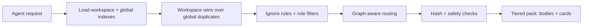

# 読み取りパスとルーティング

読み取りフローは、あるタスクに対してエージェントがどのメモリを見るかを決めます。

## 読み取りフロー

1. Engram はワークスペースと、任意のグローバルのインデックスを読み込みます。
2. 重複する場合は、ワークスペースのエントリがグローバルより優先されます。
3. 無視ルールとロールフィルターが、無関係なエントリを隠します。
4. グラフを使ったルーティングが、コンパクトなコンテキストパックを選びます。
5. 内容を出力する前に、ハッシュと安全性のチェックが実行されます。

## アンカー、ランク付け、絞り込み

`load` はまず、`rule`、`knowledge` のような一般的なメモリ用語や一般的なストップワードを無視して、意味のあるクエリ用語でルーティングのアンカーを決めます。次に、id、タグ、`directive`、要約、トリガー、本文の用語に対して BM25(軽いステミング)で候補をランク付けします。スコアは、ライフサイクル(`review_due` は x0.7)、鮮度(古い場合は x0.6)、確信度(`medium` は x0.9)、スコープ(ワークスペースは x1.1)で調整され、エージェントが取得したことのあるメモリには小さな加点があります。`valid_until` を過ぎたメモリは、省略理由 `lifecycle` で除外されます。アンカーが 4 つ以上あるクエリでは、アンカーの一致が 2 つ、または強いフィールド(id、タグ、`directive`、`applies_to` のパス)での一致が 1 つ必要です。用語の重なりがないベクトルのヒットだけでは、メモリは採用されません。

最後に、より広い候補プールをコンパクトなコンテキストパックへ絞り込みます。

通常のロードでは、`loaded 8 memory files / 14 total related memories` のように、選択された件数と関連する総件数が報告されます。

- `load --dry-run` は、候補数、絞り込みに使ったタグ、一致した理由を表示します。
- `load --all` は、コンパクトな上限を適用せず、見えているルーティング済みの一致をすべて返します。
- 既定の `load` は、エージェント向けのコンパクトなルートです。より広いレガシー出力が必要な場合は `load --full` を使います。

## 階層化された開示

既定のエージェント向け出力は階層化されています(`load.disclosure: auto`)。

- 上位 `load.expand_top` 件(既定 3)は、`### <id> [<type>, <authority>]` の下に本文として出力され、メモリに `depends_on` がある場合は `requires: <ids>` が付きます。
- 選択されたそれ以外のヒットと、省略された候補(最大 5 件)は、`- <id> [<type>] <directive-or-summary>` の 1 行カードとして出力され、ソースが変更されている場合は ` (stale)` が付きます。
- 出力の末尾には `fetch: engram load --id <ids>` が付くので、エージェントは必要なときだけ完全な本文を取得できます。

フロントマター、`## Context`、`## Example`、`## Origin` は、エージェント向けには決して表示されません。`--budget-tokens` は出力全体を制限します。Engram はまず本文をカードに変え、そのあとで初めて最も順位の低いカードを落とします。階層化をスキップするには、`--disclosure full`、`--full`、`--all` を使います。

## フックの差分とパストリガー

フックは、セッション中にすでに配信したメモリのキーを記憶します。以降のプロンプトのターンでは、新しい本文だけを注入し、残りは 1 行の `already loaded: <ids>` にまとめます。`SessionStart` と `PreCompact` はこの集合をリセットします。`applies_to` の glob を持つメモリは、`PreToolUse` のファイルイベント(Codex の `apply_patch` による編集。フックモードでは Claude の `Read`、`Edit`、`Write`、`MultiEdit`)や、Gemini の `AfterTool` イベント(`read_file`、`write_file`、`replace`)でも、必要なタイミングで注入されます。1 イベントにつき最大 3 件の本文です。`hooks.path_rules native`(既定)では、Claude と Cursor は代わりに `.claude/rules/engram/` と `.cursor/rules/engram/` 配下の生成されたルールファイルからそれらを読み込み、Claude の `InstructionsLoaded` フックが配信済みの集合を更新します。Claude と Codex のサブエージェントは `SubagentStart` を通じてルーティング済みのコンテキストとともに起動し、フックの出力は各ホストのペイロード上限(Codex は 2,400 トークン、Claude は 9,500 文字)以内に収まります。上限を超える場合、本文はカードに格下げされ、途中で切られることはありません。[フックとプルーフ行](../integrations/hooks.md) を参照してください。

`workflow` と `workflows` は引き続きスキルメモリにルーティングされますが、一般的なタイプ名だけで広い一致になることはありません。

## 依存レイヤー

あるメモリを、繰り返しを避けて別のメモリの上に積み上げたいときは、`depends_on` フロントマターを使います。

```yaml
depends_on: [release-foundation]
level: advanced
```

手動で編集したあとは `engram graph --rebuild` を実行してください。グラフは依存レイヤーを報告し、`engram load` は、より深いメモリの前に、ルーティングされた前提メモリを同じコンパクトなコンテキストパックへ取り込みます。グラフの関連エッジやベクトルのヒットだけで、無関係なメモリがロードされることはありません。それらは、意味のあるクエリ用語とすでに重なっているメモリの再ランク付けや展開を助けるだけです。明示的な `depends_on` の前提メモリは、それ自体にキーワードの重なりがなくてもロードされる場合があります。

## ルーティング図



## 次のステップ

- [書き込みパスと承認](write-path.md)
- [CLI: load / search / graph](../cli/load-search-graph.md)
