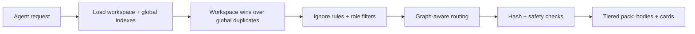

# 읽기 경로와 라우팅

읽기 흐름은 주어진 작업에 대해 에이전트가 어떤 메모리를 보게 될지 결정합니다.

## 읽기 흐름 {#read-flow}

1. Engram이 워크스페이스 인덱스와 선택적 글로벌 인덱스를 로드합니다.
2. 워크스페이스 항목이 글로벌 중복 항목보다 우선합니다.
3. 무시 규칙과 역할 필터가 관련 없는 항목을 숨깁니다.
4. 그래프 인식 라우팅이 간결한 컨텍스트 팩을 선택합니다.
5. 내용을 출력하기 전에 해시 및 안전성 검사를 수행합니다.

## 앵커, 순위, 정제 {#anchor-rank-and-refine}

`load`는 먼저 의미 있는 질의어로 라우팅의 기준점(앵커)을 잡으며, `rule`, `knowledge` 같은 일반적인 메모리 단어와 흔한 불용어는 무시합니다. 그런 다음 id, 태그, `directive`, 요약, 트리거, 본문 용어에 대해 BM25(가벼운 어간 처리)로 후보의 순위를 매깁니다. 점수는 수명 주기(`review_due` x0.7), 오래됨 여부(x0.6), 신뢰도(`medium` x0.9), 범위(워크스페이스 x1.1)에 따라 조정되며, 에이전트가 가져온 적이 있는 메모리에는 작은 가산점이 붙습니다. `valid_until`이 지난 메모리는 `lifecycle`이라는 제외 사유로 빠집니다. 앵커가 네 개 이상인 질의는 앵커 일치가 두 번이거나, 강한 필드(id, 태그, `directive`, 또는 `applies_to` 경로)에서 한 번 일치해야 합니다. 용어가 겹치지 않는 벡터 일치만으로는 메모리가 채택되지 않습니다.

마지막으로 더 넓은 후보 풀을 간결한 컨텍스트 팩으로 정제합니다.

일반 로드는 `loaded 8 memory files / 14 total related memories`처럼 선택된 개수와 전체 관련 개수를 보고합니다.

- `load --dry-run`은 후보 개수, 좁히는 태그, 일치 이유를 보여 줍니다.
- `load --all`은 간결한 한도를 적용하지 않고 보이는 라우팅 일치 항목을 모두 반환합니다.
- 기본 `load`는 에이전트용 간결한 경로입니다. 더 넓은 기존 형식 출력이 필요하면 `load --full`을 사용하세요.

## 계층화된 공개 {#tiered-disclosure}

기본 에이전트 출력은 계층화되어 있습니다(`load.disclosure: auto`).

- 상위 `load.expand_top`개(기본값 3)의 결과는 `### <id> [<type>, <authority>]` 아래에 본문으로 출력되며, 메모리에 `depends_on`이 있으면 `requires: <ids>`가 함께 표시됩니다.
- 선택된 나머지 결과와 제외된 후보 최대 5개는 `- <id> [<type>] <directive-or-summary>` 형태의 카드 한 줄로 출력되며, 소스가 바뀌었으면 ` (stale)`이 덧붙습니다.
- 출력은 `fetch: engram load --id <ids>`로 끝나므로, 에이전트는 필요할 때만 전체 본문을 가져올 수 있습니다.

Frontmatter, `## Context`, `## Example`, `## Origin`은 에이전트에게 렌더링되지 않습니다. `--budget-tokens`는 전체 출력의 크기를 제한합니다. Engram은 먼저 본문을 카드로 바꾸고, 그다음에 순위가 가장 낮은 카드를 제거합니다. 계층화를 건너뛰려면 `--disclosure full`, `--full`, `--all`을 사용하세요.

## 훅 델타와 경로 트리거 {#hook-delta-and-path-triggers}

훅은 세션에서 이미 전달한 메모리 키를 기억합니다. 이후 프롬프트 턴에서는 새로 추가된 본문만 주입하고 나머지는 `already loaded: <ids>` 한 줄로 접습니다. `SessionStart`와 `PreCompact`는 이 집합을 초기화합니다. `applies_to` glob이 있는 메모리는 `PreToolUse` 파일 이벤트(Codex `apply_patch` 편집, 훅 모드의 Claude `Read`, `Edit`, `Write`, `MultiEdit`)와 Gemini `AfterTool` 이벤트(`read_file`, `write_file`, `replace`)에서도 필요한 시점에 주입되며, 이벤트당 본문은 최대 3개입니다. `hooks.path_rules native`(기본값)에서는 Claude와 Cursor가 대신 `.claude/rules/engram/`와 `.cursor/rules/engram/` 아래의 생성된 규칙 파일에서 이를 로드하고, Claude `InstructionsLoaded` 훅이 전달된 집합을 갱신합니다. Claude와 Codex 서브에이전트는 `SubagentStart`를 통해 라우팅된 컨텍스트로 시작하며, 훅 출력은 각 호스트의 페이로드 상한(Codex는 2,400 토큰, Claude는 9,500자) 아래로 유지됩니다. 상한을 넘으면 본문이 카드로 강등되며 텍스트 중간에서 잘리지 않습니다. [훅과 증명 줄](../integrations/hooks.md)을 참고하세요.

`workflow`와 `workflows`는 여전히 skill 메모리로 라우팅되지만, 일반적인 유형 단어만으로는 넓은 일치가 이루어지지 않습니다.

## 의존성 계층 {#dependency-layers}

메모리가 다른 메모리를 반복하지 않고 그 위에 쌓여야 한다면 `depends_on` frontmatter를 사용하세요.

```yaml
depends_on: [release-foundation]
level: advanced
```

수동 편집 후에는 `engram graph --rebuild`를 실행하세요. 그래프는 의존성 계층을 보고하며, `engram load`는 라우팅된 선행 메모리를 더 깊은 메모리보다 앞서 같은 간결한 컨텍스트 팩에 포함합니다. 그래프의 관련 엣지와 벡터 일치만으로는 관련 없는 메모리를 로드할 수 없으며, 이미 의미 있는 질의어와 겹치는 메모리의 순위를 다시 매기거나 확장하는 데만 도움이 됩니다. 명시적인 `depends_on` 선행 항목은 자체 키워드가 겹치지 않아도 로드될 수 있습니다.

## 라우팅 다이어그램 {#routing-diagram}



## 다음 단계 {#next-steps}

- [쓰기 경로와 승인](write-path.md)
- [CLI: load / search / graph](../cli/load-search-graph.md)
