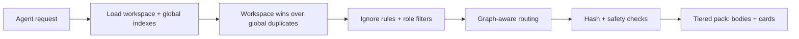

# Đường đọc và định tuyến

Luồng đọc quyết định agent thấy những bộ nhớ nào cho một tác vụ.

## Luồng đọc {#read-flow}

1. Engram nạp chỉ mục workspace và chỉ mục global tùy chọn.
2. Các mục workspace thắng các mục global trùng lặp.
3. Quy tắc bỏ qua và bộ lọc vai trò ẩn các mục không liên quan.
4. Định tuyến nhận biết đồ thị chọn ra một gói ngữ cảnh gọn.
5. Kiểm tra hash và an toàn chạy trước khi nội dung được in ra.

## Neo, xếp hạng và tinh lọc {#anchor-rank-and-refine}

`load` trước hết neo việc định tuyến vào các từ khóa có ý nghĩa của truy vấn, bỏ qua các từ chung về bộ nhớ như `rule`, `knowledge` và các từ dừng phổ biến. Sau đó nó xếp hạng các ứng viên bằng BM25 (stemming nhẹ) trên id, thẻ (tags), `directive`, tóm tắt, trigger và các từ trong nội dung. Điểm được điều chỉnh theo vòng đời (`review_due` x0.7), độ lỗi thời (x0.6), độ tin cậy (`medium` x0.9) và phạm vi (workspace x1.1), cộng một mức tăng nhỏ cho các bộ nhớ mà agent đã từng lấy. Các bộ nhớ có `valid_until` đã qua bị loại với lý do `lifecycle`. Một truy vấn có bốn neo trở lên cần hai lần trúng neo, hoặc một lần trúng ở trường mạnh (id, tag, `directive` hoặc đường dẫn `applies_to`). Các kết quả vector không trùng từ khóa sẽ không bao giờ đưa một bộ nhớ vào.

Cuối cùng nó tinh lọc tập ứng viên rộng hơn thành một gói ngữ cảnh gọn.

Lần load thông thường báo cáo số được chọn và tổng số liên quan, ví dụ `loaded 8 memory files / 14 total related memories`.

- `load --dry-run` hiển thị số lượng ứng viên, các tag thu hẹp và lý do khớp.
- `load --all` trả về mọi kết quả định tuyến nhìn thấy được thay vì áp dụng giới hạn gọn.
- `load` mặc định là tuyến gọn hướng tới agent. Dùng `load --full` cho đầu ra cũ rộng hơn.

## Hiển thị phân tầng {#tiered-disclosure}

Đầu ra agent mặc định được phân tầng (`load.disclosure: auto`):

- Các kết quả `load.expand_top` đầu tiên (mặc định 3) được in dưới dạng nội dung ở `### <id> [<type>, <authority>]`, kèm `requires: <ids>` khi bộ nhớ có `depends_on`.
- Mọi kết quả được chọn khác, cộng tối đa 5 ứng viên bị loại, được in thành một dòng thẻ, `- <id> [<type>] <directive-or-summary>`, kèm ` (stale)` khi nguồn của nó đã thay đổi.
- Đầu ra kết thúc bằng `fetch: engram load --id <ids>` để agent chỉ lấy nội dung đầy đủ khi cần.

Frontmatter, `## Context`, `## Example` và `## Origin` không bao giờ được hiển thị cho agent. `--budget-tokens` giới hạn toàn bộ đầu ra: Engram trước tiên biến nội dung thành thẻ, rồi mới loại các thẻ xếp hạng thấp nhất. Dùng `--disclosure full`, `--full` hoặc `--all` để bỏ qua việc phân tầng.

## Hook delta và trigger theo đường dẫn {#hook-delta-and-path-triggers}

Các hook ghi nhớ những khóa bộ nhớ mà chúng đã chuyển giao trong phiên. Các lượt prompt sau chỉ chèn những nội dung mới và gộp phần còn lại vào một dòng `already loaded: <ids>`. `SessionStart` và `PreCompact` đặt lại tập này. Các bộ nhớ có glob `applies_to` cũng được chèn đúng lúc trên các sự kiện tệp `PreToolUse` (chỉnh sửa `apply_patch` của Codex; `Read`, `Edit`, `Write`, `MultiEdit` của Claude ở chế độ hook) và trên sự kiện `AfterTool` của Gemini (`read_file`, `write_file`, `replace`), tối đa 3 nội dung mỗi sự kiện. Với `hooks.path_rules native` (mặc định), Claude và Cursor thay vào đó nạp chúng từ các tệp quy tắc được sinh ra dưới `.claude/rules/engram/` và `.cursor/rules/engram/`, còn hook `InstructionsLoaded` của Claude cập nhật tập đã chuyển giao. Subagent của Claude và Codex khởi đầu với ngữ cảnh đã định tuyến thông qua `SubagentStart`, và đầu ra của hook nằm dưới giới hạn payload của từng host (2,400 token trên Codex, 9,500 ký tự trên Claude): vượt giới hạn thì nội dung được hạ xuống thành thẻ và không bao giờ bị cắt giữa văn bản. Xem [Hooks và dòng proof](../integrations/hooks.md).

`workflow` và `workflows` vẫn định tuyến đến các bộ nhớ skill, nhưng các từ chỉ loại chung không tự tạo ra một kết quả khớp rộng.

## Các lớp phụ thuộc {#dependency-layers}

Dùng frontmatter `depends_on` khi một bộ nhớ nên xây dựng trên một bộ nhớ khác thay vì lặp lại nó:

```yaml
depends_on: [release-foundation]
level: advanced
```

Chạy `engram graph --rebuild` sau khi chỉnh sửa thủ công. Đồ thị báo cáo các lớp phụ thuộc, và `engram load` kéo các tiền đề đã định tuyến vào cùng gói ngữ cảnh gọn trước các bộ nhớ sâu hơn. Các cạnh liên quan của đồ thị và kết quả vector không thể tự nạp các bộ nhớ không liên quan; chúng chỉ giúp xếp hạng lại hoặc mở rộng các bộ nhớ đã trùng với các từ khóa truy vấn có ý nghĩa. Các tiền đề `depends_on` tường minh vẫn có thể được nạp mà không cần tự trùng từ khóa.

## Sơ đồ định tuyến {#routing-diagram}



## Bước tiếp theo {#next-steps}

- [Luồng ghi và phê duyệt](write-path.md)
- [CLI: load / search / graph](../cli/load-search-graph.md)
