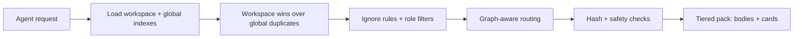

# 读取路径与路由

读取流程决定了 agent 在某个任务中能看到哪些记忆。

## 读取流程

1. Engram 加载工作区索引以及可选的全局索引。
2. 工作区条目优先于全局的重复项。
3. 忽略规则和角色过滤会隐藏无关的条目。
4. 图感知路由选出一个精简的上下文包。
5. 在打印内容之前，先运行哈希和安全检查。

## 锚定、排序与精选

`load` 首先以有意义的查询词作为路由锚点，忽略 `rule`、`knowledge` 之类的通用记忆词汇以及常见停用词。然后它使用 BM25（轻度词干提取）对 id、标签、`directive`、摘要、触发词和内容词汇的候选进行排序。得分会按生命周期（`review_due` x0.7）、过时程度（x0.6）、置信度（`medium` x0.9）和作用域（工作区 x1.1）进行缩放，并为 agent 获取过的记忆加上一个小幅加成。`valid_until` 已过的记忆会被排除，省略原因为 `lifecycle`。拥有四个或更多锚点的查询需要命中两个锚点，或在某个强字段（id、标签、`directive` 或 `applies_to` 路径）上命中一次。没有词项重叠的向量命中绝不会使某条记忆入选。

最后，它会把更大的候选池精选为一个精简的上下文包。

正常加载会报告选中数量和相关总数，例如 `loaded 8 memory files / 14 total related memories`。

- `load --dry-run` 显示候选数量、收窄用的标签以及匹配原因。
- `load --all` 返回所有可见的路由匹配项，而不是应用精简上限。
- 默认的 `load` 是面向 agent 的精简路由。需要更广泛的旧版输出时，请使用 `load --full`。

## 分层披露

默认的 agent 输出是分层的（`load.disclosure: auto`）：

- 排名靠前的 `load.expand_top` 条命中（默认 3）以正文形式打印在 `### <id> [<type>, <authority>]` 之下；当记忆带有 `depends_on` 时，还会附带 `requires: <ids>`。
- 其他每一条选中的命中，以及最多 5 个被省略的候选，都以一行卡片打印：`- <id> [<type>] <directive-or-summary>`；当其来源发生变化时，会附加 ` (stale)`。
- 输出以 `fetch: engram load --id <ids>` 结尾，这样 agent 只在需要时才拉取完整正文。

Frontmatter、`## Context`、`## Example` 和 `## Origin` 绝不会渲染给 agent。`--budget-tokens` 限制完整输出的上限：Engram 先把正文变成卡片，然后才丢弃排名最低的卡片。使用 `--disclosure full`、`--full` 或 `--all` 可跳过分层。

## Hook 增量与路径触发

Hook 会记住它们在会话中已经交付过的记忆键。之后的提示轮次只注入新增的正文，并把其余内容折叠成一行 `already loaded: <ids>`。`SessionStart` 和 `PreCompact` 会重置该集合。带有 `applies_to` glob 的记忆还会在 `PreToolUse` 文件事件（Codex 的 `apply_patch` 编辑；hook 模式下 Claude 的 `Read`、`Edit`、`Write`、`MultiEdit`）以及 Gemini 的 `AfterTool` 事件（`read_file`、`write_file`、`replace`）上被即时注入，每个事件最多 3 条正文。当 `hooks.path_rules native`（默认）时，Claude 和 Cursor 转而从 `.claude/rules/engram/` 和 `.cursor/rules/engram/` 下生成的规则文件中加载它们，并由 Claude 的 `InstructionsLoaded` hook 来更新已交付集合。Claude 和 Codex 的子 agent 通过 `SubagentStart` 以路由出的上下文启动，并且 hook 输出保持在各宿主的载荷上限之内（Codex 为 2,400 个 token，Claude 为 9,500 个字符）：超出上限时，正文会降级为卡片，绝不会在文本中途被截断。参见 [Hooks 与证明行](../integrations/hooks.md)。

`workflow` 和 `workflows` 仍然会路由到技能记忆，但通用的类型词本身不会形成宽泛的匹配。

## 依赖层

当一条记忆应当建立在另一条记忆之上而不是重复它时，请使用 `depends_on` frontmatter：

```yaml
depends_on: [release-foundation]
level: advanced
```

手动编辑之后请运行 `engram graph --rebuild`。图会报告依赖层，而 `engram load` 会在更深层的记忆之前，把路由出的前置条件拉入同一个精简上下文包。图的相关边和向量命中本身无法加载无关的记忆；它们只会帮助对已经与有意义的查询词重叠的记忆重新排序或扩展。显式的 `depends_on` 前置条件即使没有自身的关键词重叠，仍然可以被加载。

## 路由示意图



## 后续步骤

- [写入路径与审批](write-path.md)
- [CLI：load / search / graph](../cli/load-search-graph.md)
